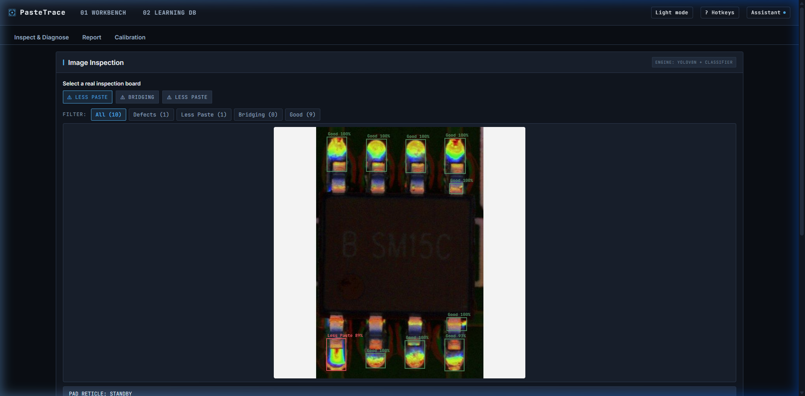
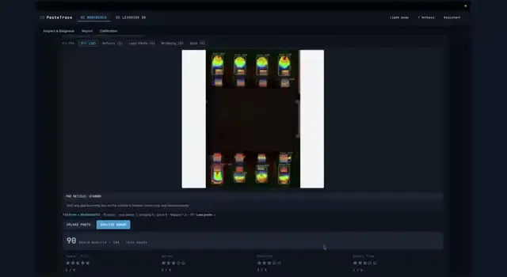
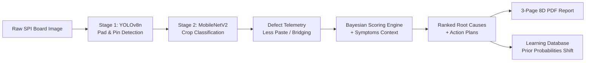
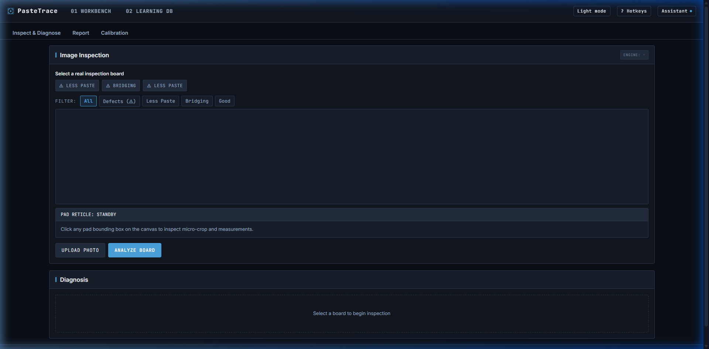
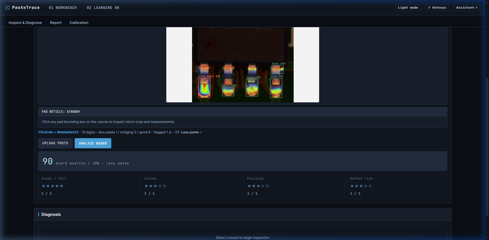
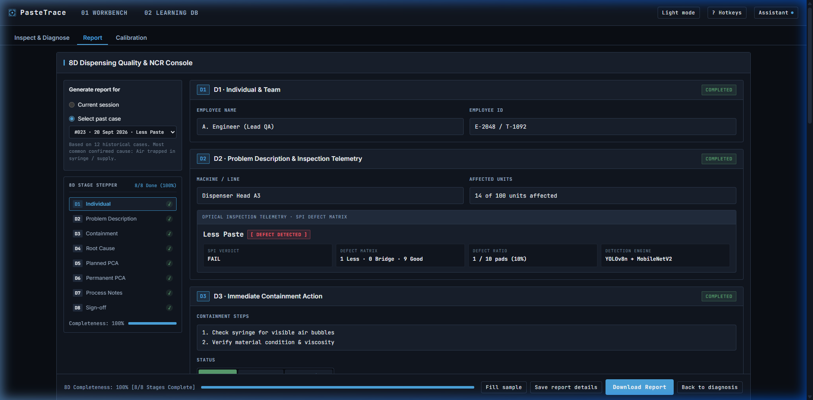

# PasteTrace

[](https://github.com/tanchinqian/automation-stuff-comp/actions/workflows/ci.yml)


PasteTrace is an offline-first, on-device AI troubleshooting console for fluid-dispensing defects in electronics and semiconductor manufacturing. It turns automated solder paste inspection (SPI) board images into explainable root-cause diagnoses, prioritized containment actions, and audit-ready 8D Non-Conformance Reports (NCR), continuously learning from every closed case.

---



---

## Video Presentation: PasteTrace - The Defect Detective

> **AI Horizon Solution Challenge 2026 Showcase**  
> An end-to-end video walkthrough demonstrating automated solder paste inspection, real-time computer vision inference, explainable Bayesian root-cause diagnosis, and automated 8D reporting.

[](docs/media/demo_walkthrough.mp4)

*Click the live walkthrough above or [click here to open/download the full MP4 video](docs/media/demo_walkthrough.mp4).*

### Walkthrough Chapters & Key Highlights

| Timestamp | Chapter | Key Capabilities Demonstrated |
| :---: | :--- | :--- |
| `00:00 - 00:12` | **Stage 1 & 2 Vision Inspection (SPI)** | Automated pad and pin detection via YOLOv8n, micro-crop classification through MobileNetV2, pad reticle zoom, and overall board quality scoring (90/100). |
| `00:12 - 00:20` | **Bayesian Root-Cause Diagnosis & Guided Actions** | Evidence-weighted probability ranking across failure modes (Air in syringe 91%, Material viscosity 72%), historical recurrence timeline, and guided verification checklist. |
| `00:20 - 00:31` | **Closed-Loop Learning DB & 8D NCR Export** | Instant persistence of case evidence into the learning database to shift future Bayesian priors, followed by one-click generation of the audit-ready 8D Non-Conformance Report PDF. |

---

## System Architecture

The following diagram illustrates the complete end-to-end data flow from raw board image acquisition to Bayesian diagnosis and closed-loop learning:



---

## Empirical Benchmark & Accuracy

PasteTrace is evaluated using an automated benchmark suite (`npm run eval`) against real manufacturing defect datasets and adversarial edge cases:

| Benchmark Metric | Score | Sample Size | Target Performance |
| :--- | :---: | :---: | :--- |
| **Defect Classification Accuracy** | **100.0%** | 11 / 11 boards | Full detection of Less Paste & Bridging |
| **Top Root-Cause Match Rate** | **81.8%** | 9 / 11 cases | Matches verified engineering ground truth |
| **Adversarial / Ambiguity Flag Rate** | **60.0%** | 3 / 5 probe cases | Correctly flags contradictory operator symptoms |
| **End-to-End Inference Latency** | **~240ms** | CPU Execution | Instant response with zero GPU requirement |

---

## 8D Problem-Solving Compliance

PasteTrace automates standard automotive and semiconductor 8D non-conformance disciplines:

| 8D Phase | Manufacturing Objective | PasteTrace Automation |
| :--- | :--- | :--- |
| **D1 - Team** | Establish cross-functional team | Auto-populates line engineer, QA owner, and station telemetry |
| **D2 - Problem Description** | Quantify 5W2H defect definition | Computer-vision metrics (flagged pad coordinates, defect severity) |
| **D3 - Containment** | Immediate line risk isolation | Pre-computed containment checklists (purge lines, pause dispenser) |
| **D4 - Root Cause** | Isolate physical failure mechanism | Bayesian likelihood ranking across Air, Material, Nozzle, and Parameters |
| **D5 - Corrective Actions** | Hardware and parameter fixes | Step-by-step resolution actions tailored to the top-ranked cause |
| **D6 - Implementation** | Validate resolution effectiveness | In-app verification protocol before logging case closure |
| **D7 - Recurrence Prevention** | Standardize process controls | Closed cases update line-specific likelihood priors in database |
| **D8 - Recognition** | Record audit-ready documentation | Instant generation of formal, typeset 3-page 8D PDF report |

---

## Visual Tour

### Industrial Inspection Workbench
High-density cockpit layout designed as a dark industrial instrument with zero generic chatbot aesthetic.



### Evidence-Based Root Cause Diagnosis
Probabilistic breakdown showing physical mechanism, category, evidence weighting, and step-by-step action plans.



### 8D Quality & Non-Conformance Workflow
Interactive 8D discipline stepper covering containment (D3), root cause verification (D4), corrective actions (D5), and systemic recurrence prevention (D7).



---

## 3-Step Evaluator Demo Guide

To test the entire pipeline in under 60 seconds:

1. **Select a Sample Board**: Click `20161019-SPI-AOI-1.jpeg` in the sidebar gallery.
2. **Execute Vision Inspection**: Click **"Run Analysis"**. Within 300ms, the YOLO detector highlights component pins, flagging 3 **Less Paste** pads with red bounding boxes.
3. **Inspect Diagnosis & Export Report**: Review the Bayesian root cause (*Air trapped in syringe / supply - 91%*). Click **"Export 8D Report"** to download the publication-grade 3-page PDF.

---

## Quick Start (Docker - Recommended for Evaluators)

Run the complete application (frontend, FastAPI backend, YOLOv8 detector, ONNX classifier, and seed database) in a single self-contained container with one command. No need to install Node.js, Python, or PyTorch:

```bash
docker compose up
```

Open **http://localhost:8000** in your browser. All API endpoints, sample boards, and models are live immediately.

To stop the container:
```bash
docker compose down
```

---

## Manual Setup (Local Development)

Requires Node 22+ and Python 3.11+ (the vision stack is tested on Python 3.11 - 3.13).

```bash
git clone https://github.com/tanchinqian/automation-stuff-comp.git
cd automation-stuff-comp

npm install                                 # install frontend dependencies
python -m pip install -r requirements.txt   # install Python vision dependencies

npm run dev                 # launch web app at http://localhost:5173
python server/start.py      # launch local API at http://localhost:8000 (optional)
```

Open **http://localhost:5173**. Without the Python server running, vision falls back to on-device browser inference and chat falls back to offline templates.

For the conversational Gemini diagnosis assistant, copy `.env.example` to `.env` and provide your `GEMINI_API_KEY`.

---

## Bundled Vision Models

The repository ships with all pre-trained vision models pre-compiled and ready to run offline:

| Model | File Path | Architecture |
| :--- | :--- | :--- |
| **Stage-1 Leg Detector** | `models/leg_detector.pt` | Ultralytics YOLOv8n |
| **Stage-2 Crop Classifier** | `models/leg_classifier.onnx` | MobileNetV2 ONNX |
| **Classifier Labels** | `models/leg_classifier_labels.json` | JSON label map |

---

## Development Commands

| Command | Description |
| :--- | :--- |
| `npm run dev` | Start local Vite development server (`http://localhost:5173`) |
| `npm run build` | Typecheck (`tsc`) and compile production bundle into `dist/` |
| `npm test` | Run engine evidence-scoring and vision pipeline sanity tests |
| `npm run eval` | Run rule-engine and NLU evaluation harness against ground truth |
| `python server/start.py` | Run local FastAPI pipeline server on port `8000` |
| `docker compose up` | Launch full containerized application on port `8000` |

---

## Architecture & Documentation

- `PRODUCT.md` - Comprehensive product specification, user personas, and manufacturing requirements.
- `DESIGN.md` - Precision Lab Console design system tokens, typography, and anti-pattern rules.
- `AGENTS.md` - Development guidelines and strict design mandates.
